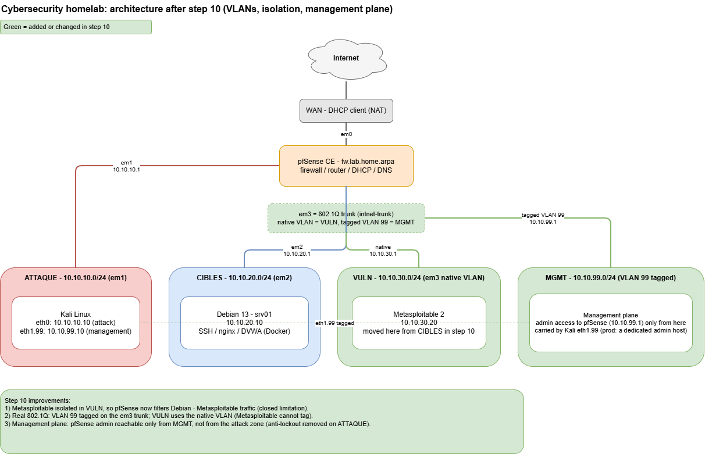

# Cybersecurity homelab

A virtualized network segmented by a **pfSense** firewall, built to practice
attack and defense in a fully isolated environment. An attacker workstation
(Kali) is separated from a server (Debian, running DVWA in Docker) and a
deliberately vulnerable target (Metasploitable 2), with every inter-zone flow
filtered, justified and tested.

The whole lab runs on a single laptop with Oracle VirtualBox. Vulnerable
machines can never reach the Internet or the home network: pfSense is the only
path between zones.

## Architecture



| Machine | Role | Zone (VLAN) | IP address |
|---------|------|-------------|------------|
| pfSense CE | Firewall / router / NAT / DHCP / DNS | WAN, ATTAQUE, CIBLES, VULN, MGMT | 10.10.10.1, 10.10.20.1, 10.10.30.1, 10.10.99.1 |
| Kali Linux | Attacker, and firewall administration | ATTAQUE (10) / MGMT (99) | 10.10.10.10, 10.10.99.10 |
| Debian 13 (srv01) | Server: SSH, nginx, DVWA in Docker | CIBLES (20) | 10.10.20.10 |
| Metasploitable 2 | Intentionally vulnerable target | VULN (native) | 10.10.30.20 |

Five zones, each a separate broadcast domain reachable only through pfSense:

- **WAN** — the way out to the Internet (VirtualBox NAT).
- **ATTAQUE** — the attacker (Kali). Internet access for tools and updates.
- **CIBLES** — the Debian server and DVWA. Updates only, no pivoting.
- **VULN** — Metasploitable, isolated so its traffic to Debian is filtered.
- **MGMT** — the only zone allowed to administer the firewall.

## Security policy (summary)

- **Vulnerable targets have no access to the Internet or to the home network.**
  Metasploitable is fully contained.
- **Metasploitable is isolated from Debian.** They sit in different VLANs, so
  pfSense filters the traffic between them; a compromised target cannot reach
  the server directly.
- **The attacker can reach the targets**; a target can only call back to Kali on
  a narrow reverse-shell port range (4444-4450), which is logged.
- **The firewall is administered only from the management VLAN (MGMT)**, never
  from the attack zone.
- **Explicit, logged default-deny on every interface.** Nothing passes unless a
  rule allows it.

Details: [addressing plan](docs/addressing-plan.md) ·
[justified firewall rules](docs/firewall-rules.md) ·
[segmentation tests](docs/tests.md) ·
[architecture and design choices](docs/architecture.md) ·
[installation log](docs/installation-log.md)

## Verifying the segmentation

A script run from Kali checks the allowed and blocked flows in one pass,
including the Debian-side checks driven over SSH:

```bash
./tests/check-lab.sh 192.168.1.1
```

It reports 14 automated checks, complemented by manual tests for the
target-side flows and the reverse shells. All 16 tests give the expected result;
firewall logs are captured as proof of each block. See [docs/tests.md](docs/tests.md).

## Skills demonstrated

Virtualization (VirtualBox), IPv4 addressing and subnetting, routing, 802.1Q
VLANs (native and tagged on a trunk), stateful packet filtering with pfSense,
NAT, DHCP and DNS, SSH key-based hardening, Docker, network segmentation and
defense-in-depth, and segmentation testing with nmap, netcat, tcpdump and a
custom bash script.

## What I learned / challenges

- **Stateful filtering and reverse shells.** Understanding why a scan from Kali
  went through while a reverse shell from a target was blocked, and writing the
  one egress rule that allows the reverse shell without opening the zone.
- **A rule that silently broke SSH.** A destination set to "CIBLES address"
  instead of "CIBLES subnets" dropped all traffic to Debian; the firewall log
  was what pointed to the cause.
- **Docker bypassing the local firewall.** DVWA published its port on 127.0.0.1
  by default, and Docker inserts its own iptables rules, which is one reason the
  filtering is done upstream on pfSense.
- **Segmentation in practice.** Moving Metasploitable to its own VLAN closed a
  limitation I had documented, and showed that separating a machine also breaks
  the legitimate rules that referenced its old network.

## Future work

- [x] VLAN dedicated to the vulnerable machine (done in step 10)
- [x] Management VLAN for the firewall (done in step 10)
- [ ] A dedicated admin host instead of a second interface on Kali
- [ ] Log centralization (syslog, then a SIEM)
- [ ] Suricata IDS on pfSense

## Use of AI

I used an AI assistant to find references, troubleshoot problems and help with
documentation. Every suggestion was checked against the official documentation
before being applied, and I made sure I understood each choice rather than
copying it blindly.

## Disclaimer

Isolated lab for educational purposes. The scanning and attack tools, and the
intentionally vulnerable machines, are only ever used inside this environment,
against my own systems. Scanning a system without authorization is a criminal
offense in most countries.